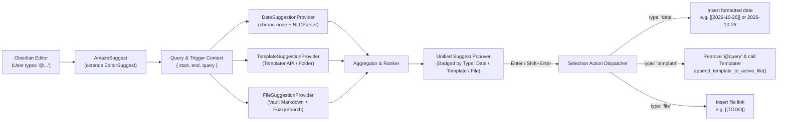

# Obsidian AmazeComplete — Plugin Design Document

## 1. Overview & Motivation

**Obsidian AmazeComplete** is a smart, unified inline autocomplete plugin for Obsidian based on the architecture and configuration model of [Natural Language Dates (`nldates-obsidian`)](https://github.com/argenos/nldates-obsidian).

When typing a configurable trigger phrase (default `@`) in the editor, AmazeComplete opens a single `EditorSuggest` popover that searches and suggests across three distinct sources simultaneously:

1. **Natural Language Dates** (e.g., `@Today`, `@next Friday`, `@in 3 days`, `@time:now`) — powered by `chrono-node` and `moment`, working identically to the Natural Language Dates plugin.
2. **Available Templates** (e.g., `@Book`, `@Meeting`) — dynamically discovered from the user's configured **Templater** template folder (with optional fallback to Obsidian's core Templates plugin). Selecting a template removes the `@query` trigger text and executes/inserts the rendered template inline at the cursor.
3. **Available Vault Files** (e.g., `@TODO`, `@Project Alpha`) — fuzzy-matched across markdown files (and aliases) in the vault. Selecting a file inserts a wiki-link (`[[TODO]]`) or standard Markdown link depending on vault settings.

---

## 2. Existing Plugin Landscape Analysis

Before designing AmazeComplete, we surveyed the Obsidian Community Plugins ecosystem to verify whether an existing plugin already fulfills these requirements:

| Plugin | Trigger | Dates (NLP) | Inline Templater Insertion | Vault File Linking | Gap Analysis |
| :--- | :--- | :---: | :---: | :---: | :--- |
| **Natural Language Dates** (`nldates-obsidian`) | `@` (configurable) | Yes (`chrono-node`) | No | No | Only handles dates and times. Attempting to use `@` in another plugin alongside `nldates` causes competing `EditorSuggest` popups. |
| **Date List** | `@` / `@@` | Yes (presets & offsets) | No | No | Focused strictly on date pickers and date range lists. |
| **Symbol Linking** (`@ Symbol Linking`) | `@` (or custom symbols) | No | Only on *new note creation* | Yes (folder/vault scoped) | Links existing notes or creates a new note from a template in a target folder, rather than expanding a Templater snippet inline at the cursor or parsing NLP dates. |
| **Various Complements** | Prefix-less / custom | No (dictionary only) | No (text snippets only) | Yes (internal link complement) | Heavyweight word/dictionary completion engine; does not execute Templater scripts or parse arbitrary natural language date expressions. |
| **Slash Commands** (Core) / **Slash Commander** | `/` | No | Via command palette proxy | No | Triggers Obsidian commands rather than unifying inline entity links, NLP dates, and templates under `@`. |

**Conclusion:** No existing plugin unifies **NLP Date parsing**, **inline Templater execution**, and **Vault File linking** behind a single `@` trigger. Furthermore, because Obsidian's `EditorSuggest` pipeline processes registered suggestors sequentially on the same trigger character, running separate `@` plugins causes UI conflicts. Building a unified plugin based on `nldates-obsidian` solves this cleanly.

---

## 3. High-Level Architecture



### Project Directory Structure

```text
amazecomplete/
├── manifest.json
├── package.json
├── tsconfig.json
├── esbuild.config.mjs
├── styles.css
└── src/
    ├── main.ts                      # Plugin lifecycle, settings & NLDParser init
    ├── settings.ts                  # AmazeSettings interface, DEFAULT_SETTINGS, SettingTab
    ├── parser.ts                    # NLDParser (ported from nldates-obsidian using chrono-node)
    ├── utils.ts                     # Link generation, fuzzy scoring, folder & ordinal helpers
    └── suggest/
        ├── amaze-suggest.ts         # Unified EditorSuggest<AmazeSuggestion>
        ├── types.ts                 # Discriminated union types for suggestions
        └── providers/
            ├── date-provider.ts     # Natural Language Date suggestions & catch-all parser
            ├── template-provider.ts # Templater discovery & inline execution
            └── file-provider.ts     # Vault file & alias fuzzy search
```

---

## 4. Configuration & Settings Design

The settings schema directly extends `NLDSettings` from `nldates-obsidian` so that users migrating from Natural Language Dates have an identical configuration experience, augmented with toggles and options for Templates and Files.

### 4.1 TypeScript Interface (`src/settings.ts`)

```typescript
export type DayOfWeek =
  | "sunday"
  | "monday"
  | "tuesday"
  | "wednesday"
  | "thursday"
  | "friday"
  | "saturday"
  | "locale-default";

export type TemplateEngineMode = "auto" | "templater" | "core-templates";

export interface AmazeSettings {
  // --- Core Autosuggest & Trigger Settings (from NLDSettings) ---
  isAutosuggestEnabled: boolean;
  autocompleteTriggerPhrase: string;

  // --- Natural Language Dates Settings (from NLDSettings) ---
  enableDates: boolean;
  autosuggestToggleLink: boolean;
  format: string;
  timeFormat: string;
  separator: string;
  weekStart: DayOfWeek;
  modalToggleTime: boolean;
  modalToggleLink: boolean;
  modalMomentFormat: string;

  // --- Template Autocomplete Settings ---
  enableTemplates: boolean;
  templateEngine: TemplateEngineMode;
  customTemplateFolder: string; // Optional override; defaults to Templater's configured folder

  // --- File Autocomplete Settings ---
  enableFiles: boolean;
  includeFileAliases: boolean;
  excludedFolders: string[];    // e.g.exclude template folder from regular file links if desired
  maxFileSuggestions: number;
  maxTemplateSuggestions: number;
}

export const DEFAULT_SETTINGS: AmazeSettings = {
  isAutosuggestEnabled: true,
  autocompleteTriggerPhrase: "@",

  // Natural Language Dates defaults
  enableDates: true,
  autosuggestToggleLink: true,
  format: "YYYY-MM-DD",
  timeFormat: "HH:mm",
  separator: " ",
  weekStart: "locale-default",
  modalToggleTime: false,
  modalToggleLink: false,
  modalMomentFormat: "YYYY-MM-DD HH:mm",

  // Template defaults
  enableTemplates: true,
  templateEngine: "auto",
  customTemplateFolder: "",

  // File defaults
  enableFiles: true,
  includeFileAliases: true,
  excludedFolders: [],
  maxFileSuggestions: 10,
  maxTemplateSuggestions: 10,
};
```

### 4.2 Settings UI Sections

Each subsection starts with a section toggle that enables/disables all dependent settings within that subsection when turned off:

1. **Autosuggest trigger**
   - **Enable autosuggest** (`isAutosuggestEnabled`): Toggle master switch ("Open the unified autocomplete menu (dates, templates, files) with trigger phrase"). Disables `Trigger phrase` when off.
   - **Trigger phrase** (`autocompleteTriggerPhrase`): Character(s) that open the autocomplete menu (default: `@`).
2. **Natural Language Dates** *(Mirrors `nldates-obsidian`)*
   - **Enable date suggestions** (`enableDates`): Toggle NLP date matching. Disables all date formatting options below when off.
   - **Add dates as link?** (`autosuggestToggleLink`): Wrap inserted dates in `[[wikilinks]]`.
   - **Date format** (`format`): Moment.js format (default: `YYYY-MM-DD`) with live preview (`addMomentFormat`).
   - **Week starts on** (`weekStart`): Dropdown (`Locale default`, `Sunday` .. `Saturday`).
   - **Time format** (`timeFormat`): Moment.js format (default: `HH:mm`).
   - **Separator** (`separator`): Separator between date and time (default: `" "`).
3. **Templates (Templater)**
   - **Enable template suggestions** (`enableTemplates`): Toggle template matching. Disables template engine and folder options below when off.
   - **Template engine** (`templateEngine`): `Auto-detect (Templater, fallback to Core Templates)`, `Templater only`, or `Core Templates only`.
   - **Template folder override** (`customTemplateFolder`): Optional path if the user wants to scope templates to a specific subfolder; when blank, automatically reads `app.plugins.plugins["templater-obsidian"].settings.templates_folder`.
4. **Files & Links**
   - **Enable file suggestions** (`enableFiles`): Toggle vault file matching. Disables file options below when off.
   - **Include frontmatter aliases** (`includeFileAliases`): Match against YAML `aliases` in addition to file `basename`.
   - **Exclude template folder from file suggestions** (`excludeTemplatesFromFiles`): Prevents templates (like `Book`) from appearing twice (once as a Template action and once as a `[[Book]]` file link).

---

## 5. Unified Suggestion Data Model

All three providers emit items conforming to a discriminated union `AmazeSuggestion`:

```typescript
import { SearchResult, TFile } from "obsidian";

export type SuggestionCategory = "date" | "template" | "file";

export interface BaseSuggestion {
  category: SuggestionCategory;
  label: string;       // Primary text shown in the list
  subLabel?: string;   // Secondary preview (e.g., "2026-10-26", template path, or file folder)
  score: number;       // Normalized relevance score for sorting
}

export interface DateSuggestion extends BaseSuggestion {
  category: "date";
  rawQuery: string;        // e.g. "Today", "next Friday", "time:now"
  parsedPreview: string;   // e.g. "2026-10-26"
  isTime: boolean;
}

export interface TemplateSuggestion extends BaseSuggestion {
  category: "template";
  file: TFile;             // The template TFile (e.g., "Templates/Book.md")
  match?: SearchResult;
}

export interface FileSuggestion extends BaseSuggestion {
  category: "file";
  file: TFile;             // The target note TFile (e.g., "TODO.md")
  alias?: string;          // Matched alias if matched via frontmatter
  match?: SearchResult;
}

export type AmazeSuggestion =
  | DateSuggestion
  | TemplateSuggestion
  | FileSuggestion;
```

---

## 6. Core Providers & Behavior

### 6.1 Trigger Detection (`onTrigger`)

Inherited directly from `nldates-obsidian`'s `DateSuggest.onTrigger`:
- Checks `this.plugin.settings.isAutosuggestEnabled`.
- Determines `startPos` from active `this.context?.start` or `{ line: cursor.line, ch: cursor.ch - triggerPhrase.length }`.
- Verifies that the text from `startPos` to `cursor` begins with `triggerPhrase` (e.g., `@`).
- **Word-boundary guard**: Inspects the character immediately preceding `startPos`. If it matches `` /[`a-zA-Z0-9]/ ``, returns `null` so email addresses (`user@domain.com`) or inline code blocks do not falsely trigger the popup.
- Extracts `query = editor.getRange(startPos, cursor).substring(triggerPhrase.length)`.

### 6.2 Provider 1: Natural Language Dates (`DateSuggestionProvider`)

Works identically to `nldates-obsidian`:
1. **Preset & Pattern Suggestions**:
   - **Empty / General query**: Suggests `"Today"`, `"Yesterday"`, `"Tomorrow"` filtered by `.toLowerCase().startsWith(query.toLowerCase())`.
   - **`time...` prefix**: Suggests `"time:now"`, `"time:+15 minutes"`, `"time:+1 hour"`, `"time:-15 minutes"`, `"time:-1 hour"`.
   - **`next | last | this` prefix**: Suggests `<ref> week`, `<ref> month`, `<ref> year`, and `<ref> Sunday`..`Saturday`.
   - **Relative offsets (`in <N>` or `<±N>`)**: Suggests `in <N> minutes/hours/days/weeks/months` and `<N> days/weeks/months ago`.
2. **Dynamic Arbitrary NLP Parsing (`chrono-node`)**:
   - Even if `query` does not start with one of the canned presets above (for example, `@2 weeks from now`, `@Christmas`, `@Nov 14`), `this.plugin.parseDate(query)` runs `NLDParser`.
   - If `parsed.moment.isValid()`, a live `DateSuggestion` is emitted showing the user's phrase and a right-aligned preview of the formatted date (e.g., `2026-12-25`).
3. **Insertion Action**:
   - If `suggestion.isTime` (`time:...`), formats using `settings.timeFormat` (plain text).
   - Otherwise formats using `settings.format`.
   - If `settings.autosuggestToggleLink` is `true`:
     - Pressing **Enter** inserts `[[2026-10-26]]` (via `generateMarkdownLink(app, dateStr)`).
     - Pressing **Shift+Enter** retains the natural language text as the display alias: `[[2026-10-26|Today]]`.

### 6.3 Provider 2: Templates (`TemplateSuggestionProvider`)

1. **Discovering Available Templates**:
   - Queries Templater's configured template folder via:
     ```typescript
     const templater = (this.app as any).plugins?.plugins?.["templater-obsidian"];
     const folderPath =
       this.plugin.settings.customTemplateFolder ||
       templater?.settings?.templates_folder ||
       this.getCoreTemplatesFolder();
     ```
   - Collects all `.md` `TFile` objects inside `folderPath` (recursively).
2. **Matching**:
   - When `query` is empty, returns the top templates alphabetically or by recent usage.
   - When `query` is non-empty, uses Obsidian's built-in `prepareFuzzySearch(query.toLowerCase())` against `file.basename` (e.g., `"Book"`).
3. **Insertion Action**:
   - First removes the `@query` text from the editor:
     ```typescript
     editor.replaceRange("", this.context.start, this.context.end);
     ```
   - Executes the template at the current cursor position:
     - **Primary (Templater)**: Calls `await templater.templater.append_template_to_active_file(suggestion.file)`. This evaluates all `<% ... %>` Templater syntax, cursor jumps (`<% tp.file.cursor() %>`), and prompts inline.
     - **Fallback (Core Templates / Raw)**: If Templater is not installed/enabled, falls back to `(this.app as any).internalPlugins?.plugins?.["templates"]?.instance?.insertTemplate(suggestion.file)` or reads the file contents via `this.app.vault.cachedRead(suggestion.file)` and inserts at the cursor.

### 6.4 Provider 3: Vault Files (`FileSuggestionProvider`)

1. **Discovering Available Files**:
   - Retrieves markdown files via `this.app.vault.getMarkdownFiles()`.
   - Excludes files residing inside the active Templates folder (unless the user disables template-folder exclusion) so `"Book"` in `Templates/Book.md` is offered as a Template rather than a duplicate raw file link.
2. **Matching**:
   - Uses `prepareFuzzySearch(query)` against each file's `basename` (e.g., `"TODO"`) and, if `includeFileAliases` is enabled, against frontmatter aliases from `this.app.metadataCache.getFileCache(file)?.frontmatter?.aliases`.
3. **Insertion Action**:
   - Generates a vault-compliant link using `generateMarkdownLink` / `this.app.fileManager.generateMarkdownLink(suggestion.file, sourcePath, undefined, suggestion.alias)`:
     - Standard selection on `TODO.md` inserts `[[TODO]]`.
     - **Shift+Enter** on an alias match inserts `[[TODO|Matched Alias]]`.

---

## 7. Ranking, Deduplication & UI Rendering

Because `@` searches across three domains at once, the popover must feel predictable, fast, and visually clear.

### 7.1 Ranking Rules

| Query State | Priority Order |
| :--- | :--- |
| **Empty query (`@`)** | 1. Top Date presets (`Today`, `Tomorrow`, `Yesterday`)<br>2. Available Templates (up to 5)<br>3. Recently modified Vault Files (up to 5) |
| **Non-empty query (`@to`, `@book`, etc.)** | 1. **Exact prefix / exact basename matches** across Dates, Templates, and Files.<br>2. **Scored fuzzy matches**: Normalized score combining prefix boost + Obsidian fuzzy score, with category tie-breaking (`Date` > `Template` > `File`).<br>3. **Arbitrary `chrono-node` date parse** (if valid and not already in preset list). |

### 7.2 Suggestion Item UI (`renderSuggestion`)

Each row in the `EditorSuggest` dropdown renders a compact, scannable layout with a category badge and preview metadata:

```text
┌──────────────────────────────────────────────────────────┐
│ [Date]     Today                              2026-10-26 │  <-- DateSuggestion
│ [Date]     Tomorrow                           2026-10-27 │  <-- DateSuggestion
│ [Template] Book                           Templates/Book │  <-- TemplateSuggestion
│ [File]     TODO                               Notes/TODO │  <-- FileSuggestion
├──────────────────────────────────────────────────────────┤
│ ↵ to insert   ⇧↵ keep text as alias   ↑↓ to navigate     │
└──────────────────────────────────────────────────────────┘
```

Icons/badges use Obsidian's built-in Lucide icon helper (`setIcon(iconEl, "calendar" | "layout-template" | "file-text")`) and clean CSS text badges—no emojis.

DOM Structure inside `renderSuggestion(suggestion: AmazeSuggestion, el: HTMLElement)`:
```html
<div class="amaze-suggest-item">
  <div class="amaze-suggest-main">
    <span class="amaze-suggest-badge amaze-badge-date">Date</span>
    <span class="amaze-suggest-label">Today</span>
  </div>
  <div class="amaze-suggest-aux">2026-10-26</div>
</div>
```

### 7.3 Keyboard Modifiers

- **`Enter` / Click**:
  - **Date**: Inserts formatted date (`[[2026-10-26]]` or `2026-10-26` per `autosuggestToggleLink`).
  - **Template**: Strips `@query` and triggers Templater's `append_template_to_active_file(file)`.
  - **File**: Inserts `[[Basename]]` (e.g., `[[TODO]]`).
- **`Shift + Enter`**:
  - **Date**: Keeps the natural language query as a link alias (e.g., `[[2026-10-26|Today]]`), matching `nldates-obsidian`.
  - **Template**: Inserts a `[[Template Name]]` link to the template file itself instead of executing it (useful when referencing a template without expanding it).
  - **File**: Includes the matched alias or folder path in the link.

---

## 8. Implementation Plan

1. **Phase 1: Project Scaffolding & NLD Core**
   - Initialize `package.json`, `tsconfig.json`, `manifest.json`, and `esbuild.config.mjs` (targeting Obsidian API + `chrono-node`).
   - Port `NLDParser` (`src/parser.ts`) and helper utilities (`src/utils.ts`) from `nldates-obsidian`.
2. **Phase 2: Settings & Configuration (`src/settings.ts`)**
   - Implement `AmazeSettings` and `AmazeSettingsTab` preserving all `Natural Language Dates` configuration items (`format`, `timeFormat`, `separator`, `weekStart`, `isAutosuggestEnabled`, `autosuggestToggleLink`, `autocompleteTriggerPhrase`) plus the Template and File settings.
3. **Phase 3: Multi-Provider `EditorSuggest` (`src/suggest/`)**
   - Implement `DateSuggestionProvider`, `TemplateSuggestionProvider` (with Templater API integration), and `FileSuggestionProvider`.
   - Implement `AmazeSuggest` (`EditorSuggest<AmazeSuggestion>`) with unified ranking, badge rendering (`styles.css`), and `Shift+Enter` scope registration.
4. **Phase 4: Verification & Release**
   - Unit test all providers (`DateSuggestionProvider`, `TemplateSuggestionProvider`, `FileSuggestionProvider`) and package `main.js`, `manifest.json`, and `styles.css` for `amazecomplete`.
