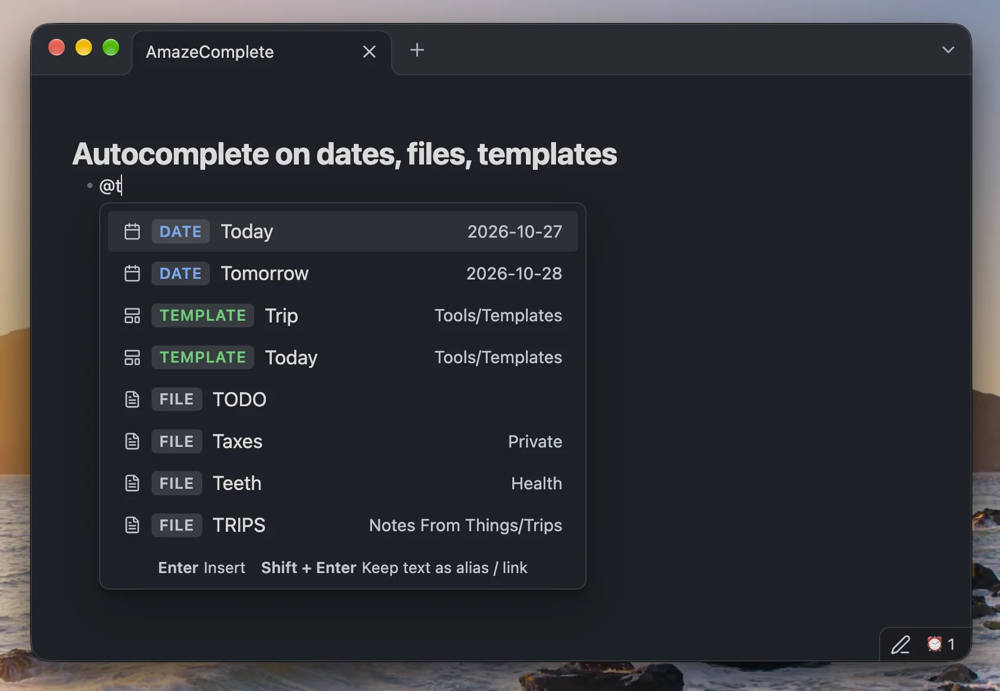

<h3 align="center">
	<br/>
	AmazeComplete for <a href="https://obsidian.md/">Obsidian</a>
</h3>
<p align="center">
    <a href="https://github.com/notnout/amazecomplete/stargazers"></a>
    <a href="https://github.com/notnout/amazecomplete/issues"></a>
    <a href="https://github.com/notnout/amazecomplete/contributors"></a>
</p>

<p align="center">
  
</p>

## AmazeComplete — unified `@` autocomplete for dates, templates, and files

**AmazeComplete** brings natural language dates, inline [Templater](https://github.com/SilentVoid13/Templater) template expansion, and vault file linking together under a single configurable trigger character (default `@`).

Built on the date-parsing foundation of [Natural Language Dates (`nldates-obsidian`)](https://github.com/argenos/nldates-obsidian), AmazeComplete extends your `@` menu so you never have to juggle separate trigger symbols or conflicting autocomplete popups.

---

### Features

- **Natural Language Dates (`DATE`)**
  - Type `@Today`, `@Tomorrow`, `@Yesterday`, `@next Friday`, `@in 3 days`, `@2 weeks ago`, `@time:now`, or any natural language date phrase powered by `chrono-node`.
  - Live formatted preview right inside the suggestion menu (e.g. `2026-10-27`).
  - Insert as `[[2026-10-27]]` wikilinks or plain text depending on your settings.
- **Inline Templates (`TEMPLATE`)**
  - Automatically discovers templates from your **Templater** template folder (with fallback support for Obsidian's core **Templates** plugin or a custom folder override).
  - Selecting a template (e.g. `@Book` or `@Trip`) strips the trigger text and executes/expands the template directly at your cursor position.
- **Vault Files & Aliases (`FILE`)**
  - Fuzzy-searches across markdown files in your vault as well as YAML frontmatter `aliases` (e.g. `@TODO`).
  - Inserts clean `[[File]]` or `[[File|Alias]]` links while automatically excluding your templates folder from duplicate file suggestions.

---

### Keyboard Shortcuts in the Popup

| Key | Action on `DATE` | Action on `TEMPLATE` | Action on `FILE` |
| :--- | :--- | :--- | :--- |
| **`Enter`** | Inserts formatted date (e.g. `[[2026-10-27]]`) | Executes & expands the template inline at cursor | Inserts file link (e.g. `[[TODO]]`) |
| **`Shift + Enter`** | Keeps natural language text as alias (`[[2026-10-27\|Today]]`) | Inserts a link to the template file (`[[Trip]]`) without expanding | Inserts link with alias |

---

### Installation

#### From Obsidian Community Plugins
1. Open **Settings → Community plugins** in Obsidian.
2. Click **Browse** and search for **AmazeComplete**.
3. Click **Install**, then **Enable**.

#### Install Manually
1. Download `main.js`, `manifest.json`, and `styles.css` from the [latest release](https://github.com/notnout/amazecomplete/releases/latest).
2. Copy them into your vault's plugin folder: `<Vault>/.obsidian/plugins/amazecomplete/`.
3. Reload Community Plugins in Obsidian and enable **AmazeComplete**.

---

### Development

```sh
npm install
npm test
npm run build
```

### Credits
- Natural language date parsing and configuration model based on [nldates-obsidian](https://github.com/argenos/nldates-obsidian) by Argentina Ortega Sainz.
